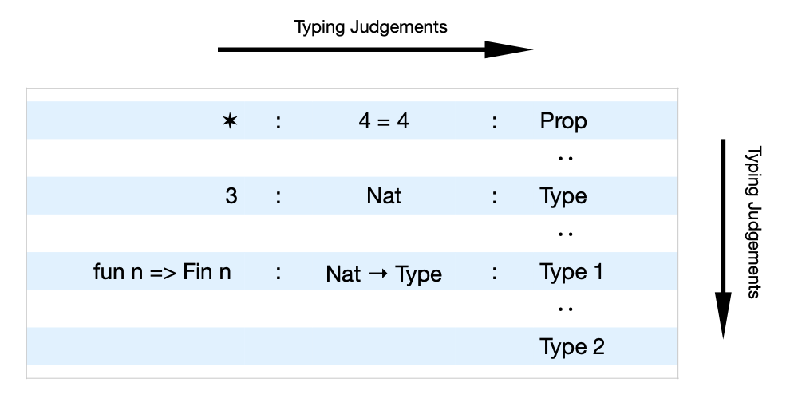

A Deeper Dive into Lean 4
=========================

Introduction and Goals
----------------------

Lean is a **functional** programming language, **statically typed** and **pure**, 
based in the theory of dependent types.

Being **functional** means that functions are the main mechanism for performing a task.
Compare with other languages such as Python or other "object oriented" languages, where
the main mechanism are "objects".

A language is **statically typed** if the process of checking the types of all the
values and variables happens at compilation time, before the code gets executed. 
For example, Python is **not** statically typed, because a variable can bind to values
of any type (except when using optional typing). 

A functional programming language is **pure** when:

- the functions **always** return the same value for the same input parameters, and
- the functions do not have side effects (which means that they cannot change any
  value, or read/write to disk or to the network, etc.).

With the previous definition, it seems that a pure language would be essentially 
useless for mostly anything. However, Lean (and other pure languages) provide a 
clever "escape hatch" which allows them to retain the theoretical soundness while
still being able to perform any side effect or external action.

With this escape hatch, Lean becomes a general purpose language that offers 
excellent safety and great practicality. The safety comes from the type theory being
currently one of the strongest theories, sound and strong enough to express any
mathematical fact. This is what makes it a theorem prover. 
At the same time, the language is very ergonomic and expressive,
and includes an increasing battery of libraries (growing by the day) which makes
Lean also a very practical tool.

In summary, Lean is two things at the same time: a general purpose programming language
**and** a theorem prover. In the next lessons we will concentrate in the practical
aspect of Lean, and we will try to learn enough of the language to write code that
verifies the output of LLM processes. And we will try to show at a very high level 
how Lean can also prove theorems about such code. The latter part will be very light,
because a full dive would be a full semester on its own.

More concretely, the goals are the following: we want to write a function with type

.. code-block:: lean4

    validate : Json -> Bool

that performs a validation of JSON objects according to some formally defined property:
:code:`P : Json -> Prop`. 
And we want
to be able to understand the statement and the basic ideas about how to prove a
theorem in Lean of the form:

.. code-block:: lean4

    theorem validateIsCorrect : ∀ (x : Json), validate x = true ↔ P x

.. tip::

    Lean might have a lot of theory behind, but at the end of the day is just
    a programming language. For this unit, we recommend thinking as when you first
    learned Python or other mainstream language. We will try to illustrate pieces
    of the foundations and the theory as we go along, but the main objective is to
    learn a new useful language.

Setting Up the Environment
--------------------------

1. Open VSCode in your laptop.
2. Connect to your class VM using remote ssh as we :ref:`described before <remote-ssh>`.
3. Open a new terminal (invoke the Command Palette with :kbd:`Ctrl-Shift-P` 
   or :kbd:`Cmd-Shift-P`, and execute the selection: :guilabel:`Terminal: Focus Terminal`).
4. Make sure your VM is up-to-date by running the command :command:`self-update` in the terminal.
5. Clone the repository *Intro to Lean* by executing the following command in the terminal:
   
   .. code-block:: console

      git clone https://github.com/waltermoreira/intro-to-lean.git
6. Open the folder :file:`intro-to-lean` in VSCode, and select the 
   file :file:`IntroToLean/Basic.lean`.
   
.. note::

    The first time you select the file it might take a minute or two while VSCode downloads
    and configures the environment. At the end of the process, you should see the contents of
    the file and also a window with title :guilabel:`Lean InfoView`.

.. tip::

    If you don't see the window :guilabel:`Lean InfoView`, you can always open it at any
    time by invoking in the Command Palette the selection 
    :guilabel:`Lean 4: InfoView: Toggle InfoView`.

    If you see a message that says:

    .. code-block:: text

        Imports are out of date and must be rebuilt; use the "Restart File" command in your editor.

    you can click the button at the lower right that says :guilabel:`Restart File`, or 
    invoke the selection :guilabel:`Lean 4: Server: Restart File` in the Command Palette.

First Steps
-----------

The Main Concept
++++++++++++++++

Before starting the interactive session, let's review the central idea that we have
stressed already in the previous units: the **Typing Judgement**

.. code-block:: lean4

    t : T 

which means that a **term** :code:`t` has **type** :code:`T` (sometimes we also say, interchangeably, that
the term :code:`t` *inhabits* the type :code:`T`). It is a very simple statement,
but it has important consequences. In all the examples that follow, and in general
in any code in Lean, you should be able to **always** put any concept in that form.
If an idea or concept is not clear while learning Lean, try to ask yourself "what is
the type of this object :code:`t` that I don't understand?". 
And similarly, you can also ask yourself "what are the terms that inhabit this type
:code:`T` that I don't understand?".

We will go a bit deeper into this in :ref:`more-about-types`, after we do some
interactive session with Lean and VSCode.

Interactive Exploration
+++++++++++++++++++++++

Open the project :file:`intro-to-lean` in VSCode as before.

.. _more-about-types:

More About the Main Concept
+++++++++++++++++++++++++++

One of the most significant aspect of Lean, that few other languages possess, is that 
**the types can have types**. In the judgement :code:`t : T`, usually :code:`t` can be also
a type, not just a term, and :code:`t` can have inhabitants of its own. A basic example is the
judgement :code:`Nat : Type`, in which :code:`Nat` is a **term** of type :code:`Type`.
But also :code:`Nat` is a type, with inhabitants such as :code:`3 : Nat`.

In addition, in Lean the terms and types can depend on each other freely (that is the
origin of the name *Dependent Typing*). We will not dig deeper into this particular aspect at the moment.

The following figure illustrates the hierarchy of types in Lean. As an exercise, try
to make sense of the several type judgment in the diagram by using an interactive session
in VSCode and try to come up with several examples for each level.

Some hints:

- the star ✶ indicates a proof of the proposition :math:`4 = 4`. What would be an
  example of judgement containing :math:`1 = 0`?

- if :code:`n : Nat` (i.e., :code:`n` is a natural number), then the type :code:`Fin n`
  represents the set :math:`\{0, 1, 2, \ldots, n - 1\}`, a set with :math:`n` elements.
  What are interesting functions one can write with this type? And what are the type
  of those functions?

The values in the infinite chain :code:`Prop : Type : Type 1 : Type 2 : Type 3 : ...` 
are called **universes** (they are also types, of course). 
Most of the time we will stay under :code:`Type 1`. From
the point of view of the compiler of the Lean language, the higher universes are 
erased after the type checking happens, and they don't have any effect in the 
generated code.  The universe :code:`Prop` also behaves in a particular way, compared
to the other universes, due to the concept of *impredicativity*. We will not dive into
that concept, but the typing :code:`Prop : Type` and these mentioned differences is an 
interesting visual indication of the duality between **proving** theorems (happening in
:code:`Prop`), and **computing** things (happening in :code:`Type`).

Some Resources
++++++++++++++

The amount of resources available for learning Lean and for reference is large. And
they can also be intimidating, due to the high level of abstraction. However, there are
a couple that will be useful for our case, especially when searching the libraries.

- `Mathlib Documentation <https://leanprover-community.github.io/mathlib4_docs/>`_:
  Despite the name, this website also contains documentation about the base language,
  including what is called the *Standard Library*. We suggest to use this website
  by searching for the name of functions we are interested in the :command:`Search`
  box at the top right.  For example, if we are interested in finding documentation 
  for a function that adds all the numbers in a list, we can enter the term:
  :code:`list sum`.

  .. tip::

    The search in this website does not accept natural language, and many times we'll
    need to know the exact name of the functions. For a more relaxed experience, use
    the next resource. However, it is still recommended to gain some familiarity with
    this website, because it's the central hub for documentation of Lean and 
    its libraries. Even third party libraries will usually have the same structure as
    this website.

- `LeanExplore <https://www.leanexplore.com>`_: This resources can take a natural 
  language description of functions, theorems, definitions, etc., and it will provide
  very good results. Think of it as a "Google" specifically for Lean. The results also
  provide a direct link to the Mathlib documentation. For example, if we want to sum
  elements of a list, we can enter :code:`sum elements of a list`. 