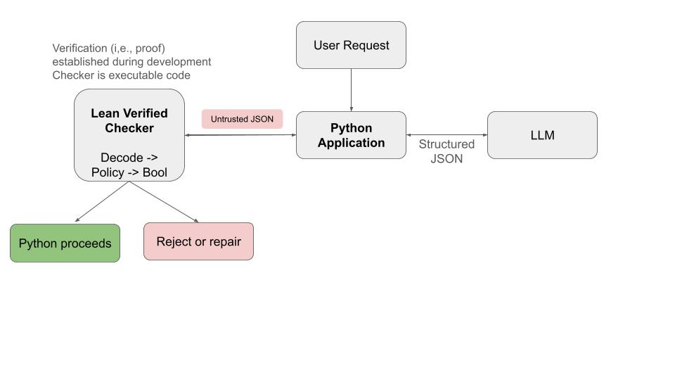

Neurosymbolic Architecture: A First Look 
=========================================

In this first lecture, we look at two application examples we have studied before: FormalLitQA, which is an example 
of a Question-Answer system leveraging retrieval augmented generation (RAG), and our Lab Equipment Management Agent 
software, which is an example of a bounded agentic application. We first discuss the limits of pure-Python JSON 
validation and then introduce a first neurosymbolic architecture pattern: the verified checker. We then show how 
to implement several of the components to realize this pattern in the FormalLitQA setting. 

By the end of this module, students should be able to: 

* Describe the basic components of a neurosymbolic architecture 
* Describe the verified checker pattern 
* Explain at a high level how the verified checker patten can be implemented in FormalLitQA and the Lab Agent software 
* Implement Lean types, a Lean checker function, and state a specification theorem in the FormalLitQA setting. 

Motivation: Limits of Structured JSON 
-------------------------------------

An Initial Example: FormalLitQA 
-------------------------------

A Second Example: Verified Tool Calling in Agentic Applications
---------------------------------------------------------------

A Common Architecture: "The Verified Checker" Pattern 
-----------------------------------------------------

FormalLitQA: Initial Implementation Details 
-------------------------------------------

Lean Types 
^^^^^^^^^^

The Lean Checker 
^^^^^^^^^^^^^^^^
We saw in the previous lecture that we can define a Lean function, ``verify``, as follows: 

.. code-block:: lean 

    def verify : Json → Bool

An Initial Specification 
^^^^^^^^^^^^^^^^^^^^^^^^

